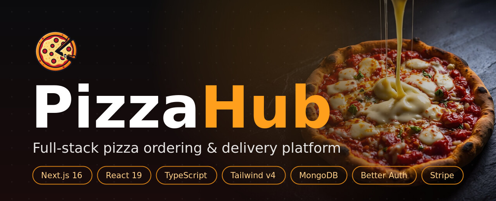

<div align="center">



# PizzaHub Server

**The REST API behind PizzaHub, a full-stack pizza ordering and delivery platform.**

     

</div>

This API serves the public menu, role protected endpoints for customers, vendors and admins, and the Premium subscription flow. The web app lives in the [client repository](https://github.com/lamiakajal/pizzahub-client).

| | |
| --- | --- |
| Live website | https://pizzahub-lamiakajal.vercel.app |
| Live server (API) | https://pizzahub-server-lamiakajal.vercel.app |
| Client repository | https://github.com/lamiakajal/pizzahub-client |
| Server repository | https://github.com/lamiakajal/pizzahub-server |

## Demo admin account

Use this account to explore the admin dashboard on the live site:

| Email | Password |
| --- | --- |
| `lamiakajal@pizzahub.com` | `LamiaKajal@123` |

This is a demo account on a demo database. Do not reuse this password anywhere else.

## Testing the Premium subscription

The live site uses Stripe in test mode. To upgrade a vendor account to Premium:

1. Sign in as a vendor and open **Subscription** in the dashboard, then click **Upgrade to Premium**.
2. On the Stripe Checkout page, pay with the test card `4242 4242 4242 4242`, any future expiry date, any 3-digit CVC and any postal code.
3. After the payment, the Premium badge appears once Stripe's verified webhook reaches the server (usually within a few seconds).

## Features

- Public menu API with search, filters, sorting and pagination.
- JWT authentication with Better Auth keys, role checks on every protected route.
- Vendors: menu item management with a free plan limit of 3 active items, order handling.
- Customers: place, list and cancel orders.
- Admins: review menu items, manage and block users, read-only transactions, overview statistics.
- Premium subscription through Stripe, activated only by a verified webhook.
- Consistent JSON responses and error handling.

## Tech stack

- Node.js, Express 5, TypeScript
- MongoDB with Mongoose 9
- Node's built-in `node:crypto` for JWT verification
- `stripe` for payments
- `cors`, `dotenv`
- `tsx` for development

## Getting started

Requirements: Node.js 22 and a MongoDB Atlas database (the same one the client uses).

```bash
git clone https://github.com/lamiakajal/pizzahub-server.git
cd pizzahub-server
npm install
cp .env.example .env
```

Fill in `.env`, then run:

```bash
npm run dev
```

The API listens on `PORT` (default 5000). Check `GET /api/health`.

| Command | What it does |
| --- | --- |
| `npm run dev` | Start with automatic reload |
| `npm run build` | Compile TypeScript to `dist` |
| `npm run start` | Run the compiled server |

## Orders flow

1. A customer opens an approved menu item and sends an order with a delivery date, delivery address and an optional message. Only customers can order: vendors and admins cannot, and nobody can order their own item.
2. A new order is `pending`. The delivery date is stored as the start of that day (UTC) and cannot be in the past.
3. A customer cannot hold two open (`pending` or `accepted`) orders for the same item and delivery date. The server answers `409`, and a unique partial index backs this up.
4. While an order is `pending`, the vendor can accept or reject it, once. The customer can cancel it. After that the status is final.

| Status | Set by | Meaning |
| --- | --- | --- |
| `pending` | System | Waiting for the restaurant |
| `accepted` | Vendor | The restaurant will deliver it |
| `rejected` | Vendor | The restaurant declined it |
| `cancelled` | Customer | The customer withdrew it |

Customers do not pay online. Stripe is used only for the vendor Premium subscription.

## Premium subscription flow

1. A vendor opens **Subscription** in the dashboard and clicks Upgrade. The client calls `POST /api/vendor/subscription/checkout`.
2. The server creates a Stripe Checkout Session in `subscription` mode with the vendor id in the metadata, and returns its URL.
3. After paying, Stripe sends the customer to `/payment/success?session_id=...`. That page is a server component that retrieves the session from Stripe and checks `status === "complete"`. It only shows the result: it does not grant Premium.
4. Premium is activated **only** by the verified webhook `POST /api/stripe/webhook`. The route uses `express.raw`, is mounted before `express.json()`, and checks the Stripe signature.
5. Handled events: `checkout.session.completed` (activate Premium, record the transaction), `invoice.payment_succeeded` (renewal, extend Premium), `invoice.payment_failed` (record the failure) and `customer.subscription.deleted` (revoke Premium).
6. Transactions are idempotent: `stripeSessionId` is unique, a Checkout Session id for the first payment and `invoice_<id>` for renewals, so a retried event never creates a duplicate.

To test locally, forward events with the Stripe CLI (`stripe listen --forward-to localhost:5000/api/stripe/webhook`), copy the printed signing secret into `STRIPE_WEBHOOK_SECRET`, and pay with the test card `4242 4242 4242 4242` (any future expiry, any CVC).

## Environment variables

Names only, never commit real values:

| Name | Purpose |
| --- | --- |
| `PORT` | Port to listen on |
| `NODE_ENV` | `development` or `production` |
| `MONGODB_URI` | MongoDB connection string |
| `CLIENT_URL` | Client origin allowed by CORS |
| `BETTER_AUTH_URL` | Client URL that serves the Better Auth JWKS |
| `STRIPE_SECRET_KEY` | Stripe secret key |
| `STRIPE_WEBHOOK_SECRET` | Signing secret of the Stripe webhook endpoint |
| `STRIPE_PREMIUM_PRICE_ID` | Stripe price id of the Premium subscription |

## API overview

Every success response is `{ success: true, message?, data, meta? }`. Errors are `{ success: false, message }`. Lists include `meta: { page, limit, total, totalPages }`.

| Area | Routes | Access |
| --- | --- | --- |
| Health | `GET /api/health` | Public |
| Current user | `GET /api/me` | Signed in |
| Menu | `GET /api/menu-items`, `/filters`, `/:id` | Public |
| Vendor menu | `/api/vendor/menu-items` | Vendor |
| Vendor orders | `/api/vendor/orders` | Vendor |
| Vendor subscription | `GET /api/vendor/subscription`, `POST /checkout`, `POST /cancel` | Vendor |
| Stripe webhook | `POST /api/stripe/webhook` | Stripe signature |
| Customer orders | `/api/customer/orders` | Customer |
| Overviews | `/api/customer/overview`, `/api/vendor/overview` (stat counts plus chart data) | Customer, vendor |
| Admin menu | `/api/admin/menu-items` | Admin |
| Admin users | `GET /api/admin/users`, `GET /api/admin/users/:id`, `PATCH /api/admin/users/:id/block` | Admin |
| Admin transactions | `GET /api/admin/transactions` (read only) | Admin |
| Admin overview | `GET /api/admin/overview` | Admin |

Admins cannot block other admins or themselves, and they cannot change payment records.

## Implementation notes for challenges

### 1. Advanced search and price sorting

`GET /api/menu-items` accepts these query parameters:

| Parameter | Effect |
| --- | --- |
| `search` | Case-insensitive match on item name or description (input is regex-escaped) |
| `category` | Exact category, validated against the allowed list |
| `location` | Case-insensitive exact match |
| `minPrice`, `maxPrice` | Inclusive price range |
| `sort` | `newest` (default), `price_asc`, `price_desc`, `featured` |
| `page`, `limit` | Pagination, default 9 and at most 24 per page |

The route builds a `$match` object (always `status: "approved"`) and passes it to the aggregation in `services/menuItemService.ts`:

1. `$match` applies the filters. Price becomes `{ $gte, $lte }`, search becomes a `$or` of two regexes.
2. `$lookup` joins the vendor from the `user` collection and `$unwind` flattens it. Items from blocked vendors are dropped on public lists.
3. `$addFields` computes `isPremium` from the vendor's plan and expiry date.
4. `$sort` uses one of the fixed sort specs: `price_asc` is `{ price: 1 }`, `price_desc` is `{ price: -1 }`, and `featured` is `{ isPremium: -1, createdAt: -1 }`. An `_id` tie breaker keeps pages stable.
5. `$facet` returns the page (`$skip`, `$limit`, `$project` of safe fields) and the total count in one round trip, which feeds `meta`.

### 2. Stripe Premium subscription

See "Premium subscription flow" above. In short: Checkout Session in subscription mode, a webhook with the raw body and signature check, Premium granted only from verified events, and idempotent transactions keyed by `stripeSessionId`.

### 3. JWT verification

1. The client app uses the Better Auth `jwt()` plugin. After sign in, `authClient.token()` returns a short-lived signed JWT.
2. The browser sends it as `Authorization: Bearer <token>`.
3. `middleware/authenticate.ts` verifies the signature and issuer with `node:crypto` against the remote key set at `BETTER_AUTH_URL/api/auth/jwks`. Keys are cached and refetched when a new key id appears.
4. The user id from the token is used to load the user from MongoDB. Role, block status and plan always come from the database, never from the token.
5. Responses: `401` for a missing, invalid or expired token or a deleted user, `403` for a blocked account.
6. `middleware/authorize.ts` (`requireRole("admin")`, or several roles) returns `403` when the role does not match. Routes mount `authenticate` first and `requireRole` second.

## Optional features

- **Dark mode:** a theme toggle in the navbar and dashboard. The choice is saved in the browser and applied before first paint.
- **Order status timeline:** the order objects include `updatedAt`, and the client details panel shows a vertical timeline for customers and vendors: order placed, then either waiting for the restaurant or the final step (accepted, rejected or cancelled) with its date.

## Deployment

| Item | Value |
| --- | --- |
| Live website | https://pizzahub-lamiakajal.vercel.app |
| Live server (API) | https://pizzahub-server-lamiakajal.vercel.app |
| Demo admin account | email: `lamiakajal@pizzahub.com` / password: `LamiaKajal@123` |

Production checklist: set every environment variable on both apps, set `CLIENT_URL` on the server to the live website, add the live Google OAuth redirect URI, and register the live webhook URL (`https://pizzahub-server-lamiakajal.vercel.app/api/stripe/webhook`) in Stripe.

## Project structure

```
src/app.ts          Express app and route mounting
src/config          Environment and database connection
src/middleware      authenticate, authorize, error handling
src/models          Mongoose models (User, MenuItem, Order, Transaction)
src/routes          One router per area
src/services        Reusable queries such as the menu aggregation
src/utils           Helpers: ApiError, respond, query, validators
```

## Deploying to Vercel

The Express app is exported from `src/app.ts`, which Vercel runs as a function. The database connection opens on the first request, so no extra entry file is needed.

1. Import the `pizzahub-server` repository in Vercel (Framework Preset: Other).
2. Add these environment variables: `MONGODB_URI`, `CLIENT_URL` (the live client URL, no trailing slash; several origins can be comma separated), `BETTER_AUTH_URL` (same as `CLIENT_URL`), `STRIPE_SECRET_KEY`, `STRIPE_PREMIUM_PRICE_ID`, `STRIPE_WEBHOOK_SECRET`, `NODE_ENV=production`.
3. In MongoDB Atlas, allow network access from `0.0.0.0/0`.
4. In the Stripe dashboard, add a webhook endpoint at `https://<server-url>/api/stripe/webhook` for `checkout.session.completed`, `invoice.payment_succeeded`, `invoice.payment_failed` and `customer.subscription.deleted`. Copy its signing secret into `STRIPE_WEBHOOK_SECRET` and redeploy.
5. Open the server URL. It should answer `{"success":true,"message":"PizzaHub API is running"}`.
